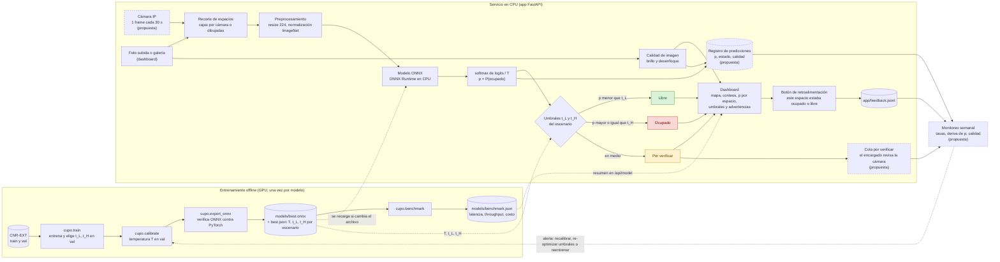

# Arquitectura del sistema desplegado y plan de monitoreo

Este documento describe cómo funciona Cupo Seguro en operación: de la imagen de la cámara al
estado de cada espacio (libre, ocupado o por verificar), qué métricas operativas se miden y cómo
se detectaría una degradación del modelo en producción.

La app de demostración (`app/`) implementa la ruta foto subida o galería → recorte →
preprocesamiento → ONNX → umbrales → dashboard → retroalimentación. Los elementos marcados como
**propuesta** (cámara IP en vivo, cola del encargado, registro de predicciones y trabajo de
monitoreo) son el diseño para producción y no están implementados en el repo.

## 1. Diagrama



Para el informe, el diagrama se puede exportar a PNG o SVG desde cualquier visor de Mermaid
(GitHub lo muestra directamente al abrir este archivo).

## 2. Componentes

| Archivo del repo | Responsabilidad |
|---|---|
| `app/static/` (`index.html`, `app.js`, `styles.css`) | Dashboard: galería, subida de fotos, dibujo de cajas, mapa coloreado por estado, conteos, P(ocupado) por espacio, umbrales del escenario, advertencias, latencia y botón de retroalimentación. |
| `app/main.py` | API FastAPI: valida la petición y la imagen, obtiene las cajas (por cámara o dibujadas), arma la respuesta por escenario, devuelve errores con mensaje claro y escribe `feedback.jsonl`. |
| `app/inference.py` | Carga `best.onnx` + `best.json` en ONNX Runtime (CPU) y los recarga si cambian; `p = softmax(logits / T)[:, 1]`; regla de decisión con `t_L` y `t_H`; calidad de imagen (brillo medio y varianza del Laplaciano); resumen de `benchmark.json`. |
| `src/cupo/frames.py` | Cajas de los espacios de cada cámara de CNR-EXT (en 1000×750) y recorte de los espacios de un frame. |
| `src/cupo/transforms.py` | `preprocess_numpy`: RGB, resize bilineal a 224×224, escala 1/255 y normalización ImageNet, igual que en evaluación. |
| `src/cupo/train.py`, `thresholds.py`, `value_model.py` | Entrenamiento y elección de `t_L`, `t_H` por escenario maximizando el valor de negocio en val. |
| `src/cupo/calibrate.py` | Temperature scaling en val y nuevos umbrales con la `p` calibrada. |
| `src/cupo/export_onnx.py` | Exporta el run a ONNX, comprueba que coincide con PyTorch y escribe `best.json` (temperatura, umbrales, preprocesamiento y métricas de val). |
| `src/cupo/benchmark.py` | Latencia, throughput, costo por predicción y volumen soportado por núcleo → `benchmark.json`. |
| `configs/value/*.yaml`, `configs/costs.yaml` | Supuestos de cada escenario (espacios, cámaras, refresco, costos) y costo de cómputo. |
| `scripts/build_gallery.py` → `app/gallery.json` | Ejemplos de demostración nunca vistos en el entrenamiento (fechas de test de CNR-EXT y CNRPark A/B). |
| `models/` (no versionado) | `best.onnx`, `best.json` y `benchmark.json` del modelo en servicio. Cambiar de modelo = reemplazar el par `.onnx` + `.json`. |
| `app/feedback.jsonl` (no versionado) | Un reporte por línea: fecha, espacio, estado reportado, estado predicho, `p_busy`, escenario, origen y modelo. Sin imágenes. |

## 3. Métricas operativas

Los números salen de `benchmark.json`, que se genera con el modelo exportado y patches de val
(nunca test):

```bash
python -m cupo.benchmark --onnx models/best.onnx --run runs/<run_id>
```

| Métrica | Campo de `benchmark.json` |
|---|---|
| Latencia p50 / p95 por espacio (batch 1), CPU 1 hilo y todos los hilos | `cpu_1_thread.per_slot`, `cpu_all_threads.per_slot` (`p50_ms`, `p95_ms`) |
| Latencia p50 / p95 por frame (46 espacios) | `cpu_1_thread.per_frame`, `cpu_all_threads.per_frame` |
| Throughput (predicciones/s) | `throughput_pred_s` de cada bloque |
| Preprocesamiento por espacio | `preprocess_ms_per_patch` |
| Costo por 1000 predicciones (Q), 1 núcleo, modelo + preprocesamiento | `costo_por_1000_pred_Q` (solo el modelo: `cost.model_only.q`) |
| Capacidad: cámaras por núcleo a 1 frame cada 30 s (y al 70 % de uso) | `volume.cameras_per_core`, `volume.cameras_per_core_at_70pct` |
| ¿Alcanza 1 núcleo para cada escenario? | `volume_by_scenario.<escenario>.core_utilization`, `fits_1_core` |
| Referencia en GPU (si hay CUDA y se pasa `--run`) | `gpu_torch` |
| CPU donde se midió | `env.cpu` |

El dashboard muestra ese resumen (vía `GET /api/model`) y avisa si el benchmark es de otro
modelo. Cada respuesta de predicción trae además su propia latencia medida en el servidor
(`latency_ms.total` y `latency_ms.model`). La tabla de iteraciones
(`python scripts/results_table.py`) incluye la latencia y el costo por predicción de cada run
que tenga `benchmark.json`.

## 4. Plan de monitoreo

**Requisito (propuesta):** registrar cada predicción servida (fecha y hora, cámara, espacio,
`p`, estado, escenario, brillo y varianza del Laplaciano, versión del modelo) en un archivo o
tabla de predicciones. Con ese registro y `feedback.jsonl`, un trabajo semanal calcula las
señales siguientes **por cámara y por franja horaria** (día, atardecer, noche), porque la
ocupación y la luz cambian a lo largo del día.

Las referencias vienen de validación: la tasa de "por verificar" de `best.json`
(`val_metrics_summary.value.<escenario>.verify_rate`) y la distribución de `p` en val
(logits de `runs/<run_id>/val_preds.npz` con la temperatura `T` del modelo).

Todos los umbrales de alerta de esta tabla son una **propuesta** inicial; se ajustan después de
las primeras 4 semanas de operación.

| Señal | Cómo se calcula | Alerta (propuesta) | Qué suele indicar |
|---|---|---|---|
| Tasa de "por verificar" | Fracción de espacios en estado por verificar, por día y cámara | Más de **5 puntos** sobre la de val durante 3 días seguidos, o más de **10 puntos** en un día | El modelo duda más: cambio de luz, cámara sucia o movida, o un tipo de vehículo o pavimento nuevo |
| Confianza media | Media de `max(p, 1 - p)` por semana | Baja más de **0.05** frente a la de val | Pérdida de confianza general (deriva de los datos o de la calibración) |
| Deriva de la distribución de `p` (PSI) | PSI semanal con 10 intervalos fijos de `p` frente a val | PSI menor que 0.10 estable; de **0.10 a 0.25** vigilar; mayor que **0.25** alerta | Cambio en la distribución de entrada. Si la confianza media no cambia y solo varía la fracción de ocupados, suele ser un cambio de ocupación real y no una degradación |
| Reportes "estaba ocupado" | Reportes con `reported_state = ocupado` y `predicted_state = libre`, por cada 1000 recomendaciones "libre" mostradas | Más del **doble** de la línea base de las primeras 4 semanas, o más del **30 %** de los reportes concentrados en una sola cámara | Aumento de errores ocupado → libre, el error caro del modelo de valor. Los reportes "estaba libre" se siguen igual, con menor prioridad |
| Brillo y desenfoque | Brillo medio y varianza del Laplaciano de cada frame (los calcula `image_quality`) | Más del **10 %** de los frames diurnos de una cámara marcados como oscuros o borrosos, o caída de más del **50 %** de su varianza del Laplaciano mediana frente a su primera semana | Lente sucio, cámara movida o desenfocada, falla de iluminación nocturna |
| Validación con muestra etiquetada | Cada mes, etiquetar a mano unos **300 espacios** al azar del registro (estratificados por cámara y franja) y calcular tasa ocupado → libre, tasa de por verificar, ECE y valor con `value_model.py` | Tasa ocupado → libre por encima del límite superior del IC95 de val, o ECE mayor que **0.05** | Confirma (o descarta) la degradación que sugieren las señales anteriores |

### Qué hacer ante cada alerta

1. **Revisar primero la cámara** si la alerta se concentra en una cámara o coincide con una
   alerta de brillo o desenfoque: limpiar el lente, corregir la posición y, si la cámara se
   movió, volver a definir sus cajas. No se toca el modelo.
2. **Modo conservador mientras se diagnostica** (propuesta): bajar `t_L` en `best.json` para
   mandar más espacios dudosos a "por verificar". Sube el trabajo del encargado, pero baja el
   riesgo de mandar a un conductor a un espacio ocupado. La app toma el cambio sin reiniciar.
3. **Recalibrar** si la confianza o el ECE cambian pero la exactitud en la muestra etiquetada
   se mantiene: ajustar de nuevo la temperatura `T` con la muestra etiquetada como nueva val
   (mismo procedimiento que `cupo.calibrate`).
4. **Re-optimizar los umbrales** si sube la tasa de "por verificar" con errores estables: volver
   a elegir `t_L` y `t_H` maximizando el valor del escenario en la nueva val
   (`thresholds.py` + `value_model.py`).
5. **Reentrenar** si suben los errores ocupado → libre en la muestra etiquetada: agregar las
   imágenes etiquetadas del parqueo al entrenamiento, correr un nuevo run con su
   `configs/*.yaml`, elegir por valor en val, exportar con `cupo.export_onnx` y reemplazar
   `best.onnx` + `best.json`. Medir otra vez con `cupo.benchmark`.

## 5. Manejo de errores y comunicación de la incertidumbre

Lo que ya hace la app:

- **Tres estados en vez de dos.** Si el modelo no está seguro (`t_L ≤ p < t_H`), el espacio se
  muestra en amarillo como "por verificar" y el encargado lo revisa, en lugar de forzar una
  respuesta. Los umbrales dependen del escenario (comercial o UVG) y el dashboard los muestra.
- **Probabilidad visible.** Al pasar el cursor o seleccionar un espacio se ve `P(ocupado)`
  calibrada con la temperatura del modelo; `GET /api/model` explica la regla de decisión.
- **Advertencias de calidad.** Imagen muy oscura (brillo medio menor que 40) o borrosa (varianza
  del Laplaciano baja): la predicción se entrega con un aviso visible de que puede no ser fiable.
  También avisa si la foto no tiene la proporción 4:3 de las cámaras (las cajas pueden no
  coincidir), si en el modo "un espacio" la foto parece mostrar varios, o si se ignoraron cajas
  fuera de la imagen.
- **Errores con mensaje claro.** Archivo vacío o que no es imagen: 400. Más de 15 MB o de
  50 megapíxeles: 413. Frame menor que 320×240, cámara fuera de 1-9 o sin cajas dibujadas: 400.
  Sin modelo exportado, con `best.json` inválido o sin las cajas de la cámara: 503 con la
  instrucción para resolverlo. Cualquier otro error: 500 sin detalles internos (el detalle queda
  en el log).
- **Retroalimentación.** El botón "este espacio estaba ocupado / libre" guarda el reporte
  validado (estados, escenario, `p_busy` en [0, 1], cuerpo de máximo 2 KB) en `feedback.jsonl`,
  que alimenta el monitoreo.
- **Privacidad y cambio de modelo.** Las fotos subidas se procesan en memoria y no se guardan.
  Reemplazar `best.onnx` + `best.json` cambia el modelo sin reiniciar el servicio; el dashboard
  avisa si el benchmark mostrado corresponde a otro modelo.
