# EDA de CNRPark+EXT

Generado con `python scripts/eda.py --sample-per-split 3000 --seed 0 --full-hash` (tiempo de ejecución: 48 s).

test y ood se usan solo para estadística descriptiva; no se evalúa ningún modelo sobre ellos.

## Hallazgos clave

- Tamaños: train 94,493 (50.4 % ocupado), val 18,647 (71.9 % ocupado), test 31,825 (57.4 % ocupado), ood 12,584 (66.8 % ocupado).
- El balance cambia entre particiones: val (71.9 % ocupado) está más cargada hacia ocupado que train (50.4 %); por eso el modelo de valor repondera con la ocupación del escenario y no usa la proporción de val.
- Val no tiene lluvia (0 patches con lluvia): el desempeño con lluvia solo se verá en test. Se reportará por clima y se declara como limitación.
- Ood (CNRPark A/B) es todo soleado, de julio de 2015 y con 2 cámaras distintas a las de EXT: mide el cambio de parqueo, no el de clima.
- Fechas compartidas entre particiones: 0 (separación por fecha confirmada, sin fuga por días).
- Pocos espacios son extremos en train: 1 ocupado(s) y 1 libre(s) ≥95 % del tiempo; 2 y 2 con umbral 80 % (de 164 espacios; 1.9 % de los patches).
- Atajos sin mirar la imagen (AUC en val): espacio 0.622, cámara 0.548, hora 0.876, espacio + hora 0.892. No hay atajo fuerte por posición; la hora sí predice, pero el modelo solo la vería a través de la iluminación.
- Señales simples de imagen (AUC en la muestra de val): contraste 0.955; brillo 0.440 (relación inversa leve, max(AUC, 1 − AUC) = 0.560).
- Imágenes muy oscuras (<40) en la muestra: train 39, val 39, test 16, ood 0; 37 % de 7-8h y 55 % de 16h en adelante (38.3 % ocupadas). 18 son prácticamente negras y 7 de ellas están etiquetadas como ocupadas: error irreducible, candidatas a 'por verificar'.
- Calidad (muestra): 0 archivos corruptos, 322 con tamaño distinto de 150x150 (recortes de borde) y 0 duplicados exactos entre train y test.
- Nulos: 0 en LABELS y 0 en las columnas usadas del CSV; `occupant_changed` tiene 69,931 nulos pero no se usa. 26 patches (0.018 %) tienen etiqueta distinta en LABELS y en `occupancy` del CSV; se usan las de LABELS.
- Solo hay imágenes de día (07:00 a 18:12), de un parqueo italiano con cámaras elevadas: la transferencia a un parqueo guatemalteco no está garantizada (sección 8).
- Hash completo train/test: 1 contenido(s) de archivo compartido(s): 38 patches negros idénticos con etiquetas contradictorias (3 ocupados, 35 libres), ruido de etiqueta y no fuga (sección 6).

## 1. Particiones

| partición | patches | ocupados | libres | % ocupado | cámaras | fechas | espacios |
|---|---|---|---|---|---|---|---|
| train | 94,493 | 47,616 | 46,877 | 50.4 | 9 | 15 | 164 |
| val | 18,647 | 13,415 | 5,232 | 71.9 | 9 | 3 | 164 |
| test | 31,825 | 18,276 | 13,549 | 57.4 | 9 | 5 | 164 |
| ood | 12,584 | 8,402 | 4,182 | 66.8 | 2 | 2 | 53 |

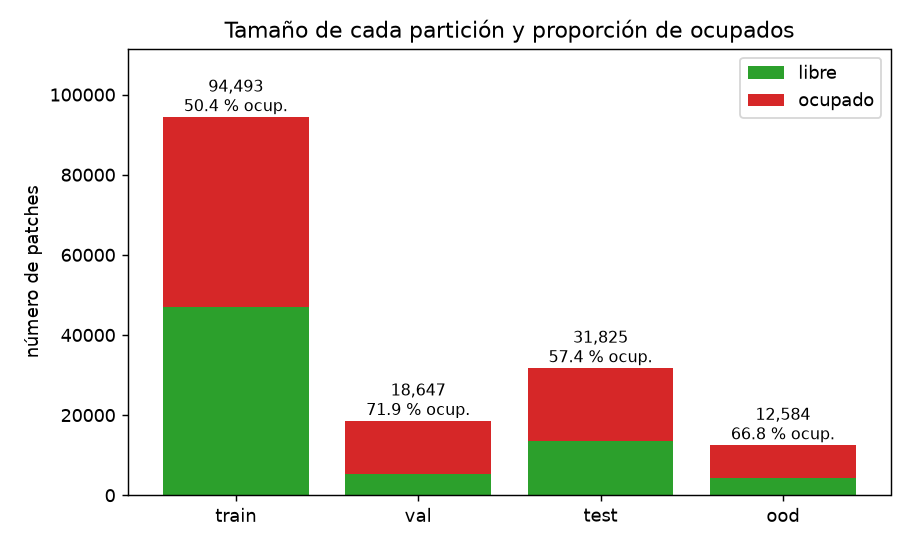

## 2. Balance de clases por cámara y por clima

**Verificación:** val tiene 0 patches con lluvia (confirmado: val no tiene lluvia).
Climas presentes en ood: soleado
(confirmado: ood es todo soleado).

### Por clima
| partición | clima | n | % de la partición | % ocupado |
|---|---|---|---|---|
| train | soleado | 44,232 | 46.8 | 63.6 |
| train | nublado | 25,577 | 27.1 | 37.5 |
| train | lluvia | 24,684 | 26.1 | 40.0 |
| val | soleado | 6,346 | 34.0 | 70.8 |
| val | nublado | 12,301 | 66.0 | 72.5 |
| val | lluvia | 0 | 0.0 |  |
| test | soleado | 12,600 | 39.6 | 38.7 |
| test | nublado | 6,365 | 20.0 | 73.2 |
| test | lluvia | 12,860 | 40.4 | 68.0 |
| ood | soleado | 12,584 | 100.0 | 66.8 |
| ood | nublado | 0 | 0.0 |  |
| ood | lluvia | 0 | 0.0 |  |

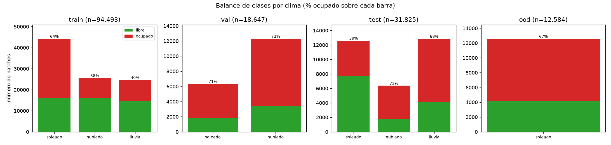

### Por cámara
| cámara | train n | val n | test n | ood n | train % ocup. | val % ocup. | test % ocup. | ood % ocup. |
|---|---|---|---|---|---|---|---|---|
| 1 | 10,255 | 2,030 | 3,430 |  | 54.7 | 76.6 | 62.6 |  |
| 2 | 2,682 | 522 | 891 |  | 61.2 | 79.5 | 65.5 |  |
| 3 | 6,174 | 1,197 | 2,100 |  | 51.8 | 75.8 | 60.1 |  |
| 4 | 10,804 | 2,072 | 3,700 |  | 52.0 | 75.9 | 58.6 |  |
| 5 | 13,570 | 2,668 | 4,600 |  | 49.8 | 71.6 | 56.3 |  |
| 6 | 13,112 | 2,640 | 4,356 |  | 48.5 | 70.5 | 55.7 |  |
| 7 | 13,754 | 2,760 | 4,600 |  | 45.8 | 65.8 | 52.4 |  |
| 8 | 15,714 | 3,078 | 5,292 |  | 49.4 | 70.0 | 55.4 |  |
| 9 | 8,428 | 1,680 | 2,856 |  | 52.0 | 73.1 | 61.3 |  |
| A |  |  |  | 6,171 |  |  |  | 58.7 |
| B |  |  |  | 6,413 |  |  |  | 74.6 |

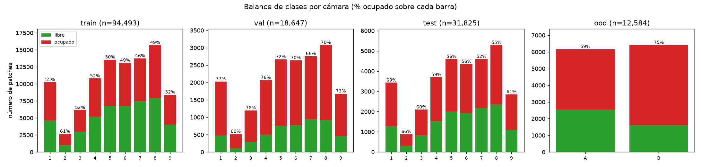

## 3. Distribución temporal

| partición | fechas | desde | hasta | lista |
|---|---|---|---|---|
| train | 15 | 2015-11-12 | 2016-01-18 | 2015-11-12, 2015-11-20, 2015-11-21, 2015-11-22, 2015-11-25, 2015-11-27, 2015-11-29, 2015-12-10, 2015-12-19, 2016-01-08, 2016-01-09, 2016-01-12, 2016-01-13, 2016-01-14, 2016-01-18 |
| val | 3 | 2015-11-16 | 2016-01-15 | 2015-11-16, 2015-12-18, 2016-01-15 |
| test | 5 | 2015-12-03 | 2016-02-12 | 2015-12-03, 2015-12-17, 2015-12-22, 2016-01-16, 2016-02-12 |
| ood | 2 | 2015-07-03 | 2015-07-08 | 2015-07-03, 2015-07-08 |

| par | fechas compartidas |
|---|---|
| train ∩ val | 0 |
| train ∩ test | 0 |
| train ∩ ood | 0 |
| val ∩ test | 0 |
| val ∩ ood | 0 |
| test ∩ ood | 0 |

**Sin fechas compartidas entre particiones: no hay fuga por días repetidos.**

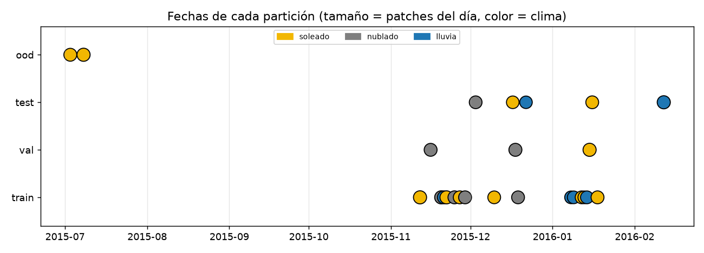

### % ocupado por hora
| hora | train | val | test | ood |
|---|---|---|---|---|
| 7 | 6.3 | 8.4 | 7.4 |  |
| 8 | 11.9 | 15.3 | 13.1 | 15.2 |
| 9 | 37.5 | 55.5 | 40.7 | 44.6 |
| 10 | 63.9 | 97.2 | 74.4 | 79.9 |
| 11 | 67.4 | 98.5 | 78.9 | 91.4 |
| 12 | 65.5 | 95.3 | 76.5 | 90.4 |
| 13 | 57.3 | 85.2 | 68.3 | 80.8 |
| 14 | 58.7 | 87.2 | 68.9 | 76.3 |
| 15 | 62.1 | 87.2 | 71.4 | 76.5 |
| 16 | 56.6 | 76.9 | 63.9 | 66.3 |
| 17 | 63.7 | 65.9 | 38.5 | 47.0 |
| 18 |  |  | 53.6 | 36.5 |

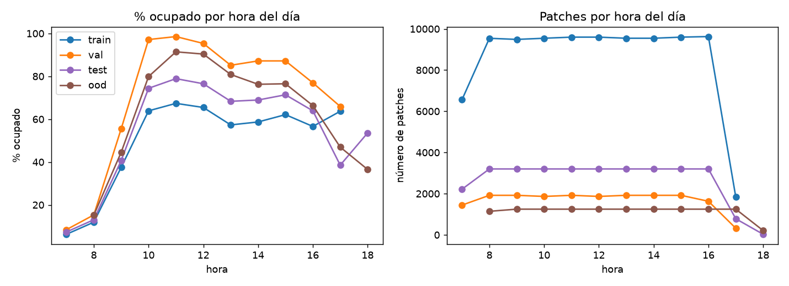

## 4. Ocupación por espacio y otros atajos posibles

Espacios con ocupación extrema (solo espacios con al menos 20 patches):

| partición | espacios (n≥20) | ocupados ≥95% | libres ≥95% | % patches (umbral 95%) | ocupados ≥80% | libres ≥80% | % patches (umbral 80%) |
|---|---|---|---|---|---|---|---|
| train | 164 | 1 | 1 | 0.9 | 2 | 2 | 1.9 |
| val | 164 | 6 | 0 | 2.8 | 45 | 1 | 25.9 |
| test | 164 | 0 | 1 | 0.3 | 6 | 2 | 4.4 |
| ood | 53 | 1 | 0 | 1.9 | 13 | 0 | 25.0 |

Espacios más extremos en train:

| slot_id | % ocupado (train) | patches (train) |
|---|---|---|
| 207 | 4.0 | 299 |
| 206 | 9.7 | 299 |
| 320 | 34.9 | 590 |
| 185 | 35.7 | 591 |
| 315 | 37.4 | 888 |
| 288 | 76.6 | 291 |
| 331 | 78.7 | 301 |
| 196 | 79.5 | 585 |
| 184 | 83.4 | 591 |
| 186 | 100.0 | 591 |

**Atajos medidos en validación** (la "predicción" es la tasa de ocupación de train para ese espacio, hora o
cámara; no se mira la imagen):

| predictor (tasa de train por…) | AUC val | accuracy val (umbral 0.5) |
|---|---|---|
| espacio | 0.622 | 55.3 |
| hora | 0.876 | 84.4 |
| cámara | 0.548 | 48.7 |
| espacio + hora | 0.892 | 84.3 |
| siempre 'ocupado' (mayoritaria de train) | 0.500 | 71.9 |

- Correlación de la tasa de ocupación por espacio entre train y val: r = 0.76 (164 espacios en común).
- El espacio por sí solo predice poco (AUC 0.62): no hay un atajo fuerte por posición, porque casi
  ningún espacio está siempre ocupado o siempre libre en train. La **hora del día** predice mucho más
  (AUC 0.88; 0.89 combinada con el espacio). El modelo no recibe la hora; solo podría
  inferirla por la iluminación, y el brillo por sí solo casi no separa las clases (sección 5). Aun así conviene
  revisarlo con Grad-CAM, con el desglose por clima y con ood (espacios y cámaras nuevos).
- La ocupación cambia mucho con la hora (en val: 8 % a las 7h y
  99 % a las 11h): respalda usar una ocupación de escenario `π` (hora pico) en el
  modelo de valor en lugar de la proporción de una partición.

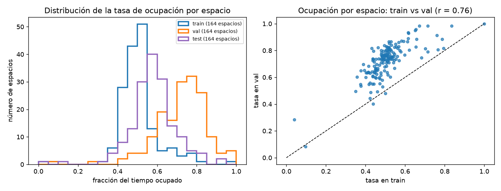

## 5. Estadísticas de imagen (muestra estratificada)

Muestra proporcional por clima y clase: hasta 3,000 patches por partición, semilla 0.
Brillo = media de la imagen en escala de grises; contraste = desviación estándar.

| partición | clima | clase | brillo medio | brillo desv. | contraste medio | contraste desv. |
|---|---|---|---|---|---|---|
| train | lluvia | libre | 103.1 | 19.9 | 10.4 | 5.0 |
| train | lluvia | ocupado | 105.8 | 29.7 | 33.9 | 17.9 |
| train | nublado | libre | 99.8 | 21.3 | 11.5 | 5.0 |
| train | nublado | ocupado | 102.8 | 32.2 | 45.9 | 18.4 |
| train | soleado | libre | 107.1 | 25.3 | 17.0 | 9.0 |
| train | soleado | ocupado | 100.4 | 27.1 | 42.4 | 16.0 |
| val | nublado | libre | 95.0 | 22.5 | 13.3 | 5.6 |
| val | nublado | ocupado | 92.9 | 27.0 | 41.7 | 16.5 |
| val | soleado | libre | 112.4 | 26.4 | 13.7 | 11.1 |
| val | soleado | ocupado | 106.7 | 30.3 | 43.3 | 15.7 |
| test | lluvia | libre | 104.0 | 21.1 | 10.8 | 6.1 |
| test | lluvia | ocupado | 108.9 | 27.7 | 37.2 | 16.8 |
| test | nublado | libre | 94.0 | 22.6 | 12.7 | 4.6 |
| test | nublado | ocupado | 99.2 | 26.4 | 42.7 | 16.4 |
| test | soleado | libre | 102.0 | 23.1 | 16.9 | 7.2 |
| test | soleado | ocupado | 102.8 | 25.5 | 42.5 | 13.5 |
| ood | soleado | libre | 122.1 | 28.0 | 19.7 | 8.8 |
| ood | soleado | ocupado | 107.1 | 23.2 | 41.0 | 13.6 |

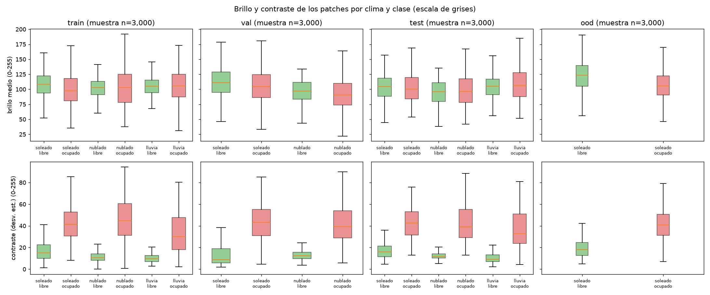

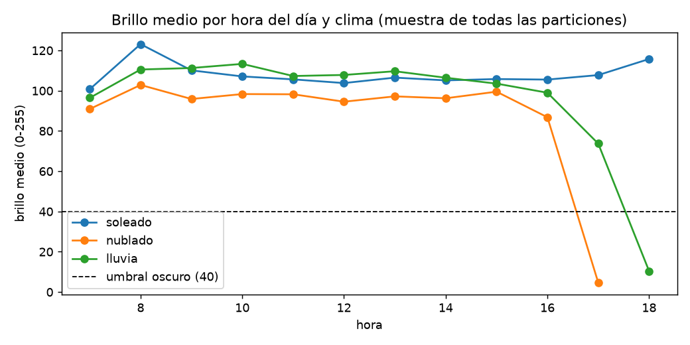

- **El contraste separa mucho las clases:** un espacio libre es asfalto casi uniforme (contraste medio 10-17 según partición y clima) y un auto agrega bordes (contraste medio 34-46). Usado solo como puntaje da
  AUC = 0.955 en la muestra de val. Esto explica por qué un clasificador clásico (HOG) ya
  funciona bien, y sugiere que los errores se concentrarán en sombras fuertes (soleado) y en autos oscuros o de
  poco contraste.
- **El brillo casi no separa las clases:** AUC = 0.440 en val
  (relación inversa leve: los ocupados son un poco más oscuros;
  max(AUC, 1 − AUC) = 0.560).
- En ood (CNRPark) el brillo medio de los espacios libres es 122, frente a 94-112 en EXT: el pavimento se ve más claro, hay cambio de dominio en la apariencia.

### Imágenes oscuras o atípicas
| partición | muestra | muy oscuras (<40) | casi negras (<10) | sobreexpuestas (>200) | atípicas en brillo (z robusto > 3.5) | % ocupado entre las oscuras |
|---|---|---|---|---|---|---|
| train | 3,000 | 39 | 16 | 1 | 36 | 33.3 |
| val | 3,000 | 39 | 2 | 5 | 5 | 51.3 |
| test | 3,000 | 16 | 0 | 1 | 6 | 18.8 |
| ood | 3,000 | 0 | 0 | 6 | 5 |  |

Horas de las imágenes muy oscuras: 7h (34), 8h (1), 9h (1), 10h (1), 12h (1), 13h (1), 14h (2), 15h (1), 16h (21), 17h (30), 18h (1).
En esta corrida: el 37 % es de las 7-8h y el 55 % de las 16h en adelante (por clima: nublado 56, lluvia 24, soleado 14). Entre ellas hay
18 prácticamente negras (brillo <10), de las cuales
7 están etiquetadas como ocupadas: con esos píxeles la clase no se puede
decidir, así que son error irreducible y el caso natural para "por verificar".

Sobreexpuestas (brillo >200) en esta corrida: EXT: 7 (100 % ocupadas; horas 09:35, 10:05, 10:10, 11:17, 11:40, 14:40). Son autos claros o con destello solar (ver 09_atipicas.png). Con solo 7 casos es una observación débil, pero sugiere que el brillo extremo aparece sobre todo con 'ocupado'; ood: 6 (0 % ocupadas; horas 08:05, 08:10). Todas son pavimento libre muy claro con el sol bajo (ver 09_atipicas.png).

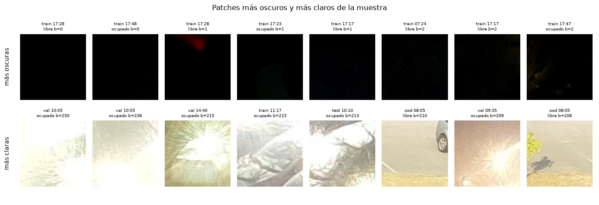

## 6. Calidad de los archivos (muestra)

| partición | muestra | corruptas | tamaño ≠ 150x150 | duplicados internos (archivo) | duplicados internos (píxeles) |
|---|---|---|---|---|---|
| train | 3,000 | 0 | 64 | 0 | 0 |
| val | 3,000 | 0 | 64 | 0 | 0 |
| test | 3,000 | 0 | 70 | 0 | 0 |
| ood | 3,000 | 0 | 124 | 0 | 0 |

Duplicados exactos entre particiones (hash MD5 de la muestra; posible fuga si > 0):

| par | archivo idéntico | píxeles idénticos |
|---|---|---|
| train ∩ test | 0 | 0 |
| train ∩ val | 0 | 0 |
| val ∩ test | 0 | 0 |
| train ∩ ood | 0 | 0 |

Hash completo (no solo la muestra): 94,493 archivos de train y 31,825 de test; **1 contenidos de archivo compartidos**.

| md5 | archivos train | archivos test | ocupados | brillo |
|---|---|---|---|---|
| 31492602a7 | 36 | 2 | 3 | 0.0 |

Todos los contenidos repetidos son patches completamente negros (cámara sin luz), no fotos reales repetidas: no es una fuga de información entre train y test. Los 38 archivos idénticos tienen etiquetas contradictorias (3 ocupados y 35 libres): es **ruido de etiqueta**. Ningún modelo puede acertar todos; aportan un piso de error y deberían caer en "por verificar".

Tamaños distintos de 150x150 (patches recortados en el borde del frame; el Resize del preprocesamiento los lleva al tamaño de entrada):

| partición | n | tamaños |
|---|---|---|
| train | 64 | 126x150, 138x150, 150x137, 150x138, 150x142, 150x147, 150x148 |
| val | 64 | 126x150, 138x150, 150x137, 150x138, 150x142, 150x147, 150x148 |
| test | 70 | 126x150, 138x150, 150x137, 150x138, 150x142, 150x147, 150x148 |
| ood | 124 | 113x150, 127x150, 133x150, 150x143 |

No se encontraron archivos corruptos o ilegibles en la muestra.

### Valores nulos y consistencia de etiquetas (todas las filas, no la muestra)

Esta subsección se calcula sobre todas las filas de LABELS/{train,val,test}.txt y de CNRPark+EXT.csv.

| archivo | filas | nulos | etiquetas fuera de {0,1} |
|---|---|---|---|
| LABELS/train.txt | 94,493 | 0 | 0 |
| LABELS/val.txt | 18,647 | 0 | 0 |
| LABELS/test.txt | 31,825 | 0 | 0 |

| columna del CSV | nulos | se usa |
|---|---|---|
| camera | 0 | sí |
| datetime | 0 | sí |
| day | 0 | no |
| hour | 0 | sí |
| image_url | 0 | sí |
| minute | 0 | sí |
| month | 0 | no |
| occupancy | 0 | sí |
| slot_id | 0 | sí |
| weather | 0 | sí |
| year | 0 | no |
| occupant_changed | 69,931 | no |

- Nulos en LABELS: 0. Nulos en las columnas del CSV que se usan: 0. `occupant_changed` tiene 69,931 nulos pero no se usa en el proyecto.
- Acuerdo entre LABELS y la columna `occupancy` del CSV (mismo archivo):

| partición | patches | sin fila en el CSV | etiqueta distinta | % distinta |
|---|---|---|---|---|
| train | 94,493 | 0 | 20 | 0.021 |
| val | 18,647 | 0 | 2 | 0.011 |
| test | 31,825 | 0 | 4 | 0.013 |

- En total, 26 de 144,965 patches (0.018 %) tienen etiqueta distinta en LABELS y en el CSV,
  y 0 no aparecen en el CSV. El proyecto usa siempre las etiquetas de LABELS (particiones oficiales);
  el CSV solo aporta metadatos de ood y las etiquetas de los frames completos de la demo.

## 7. Ejemplos

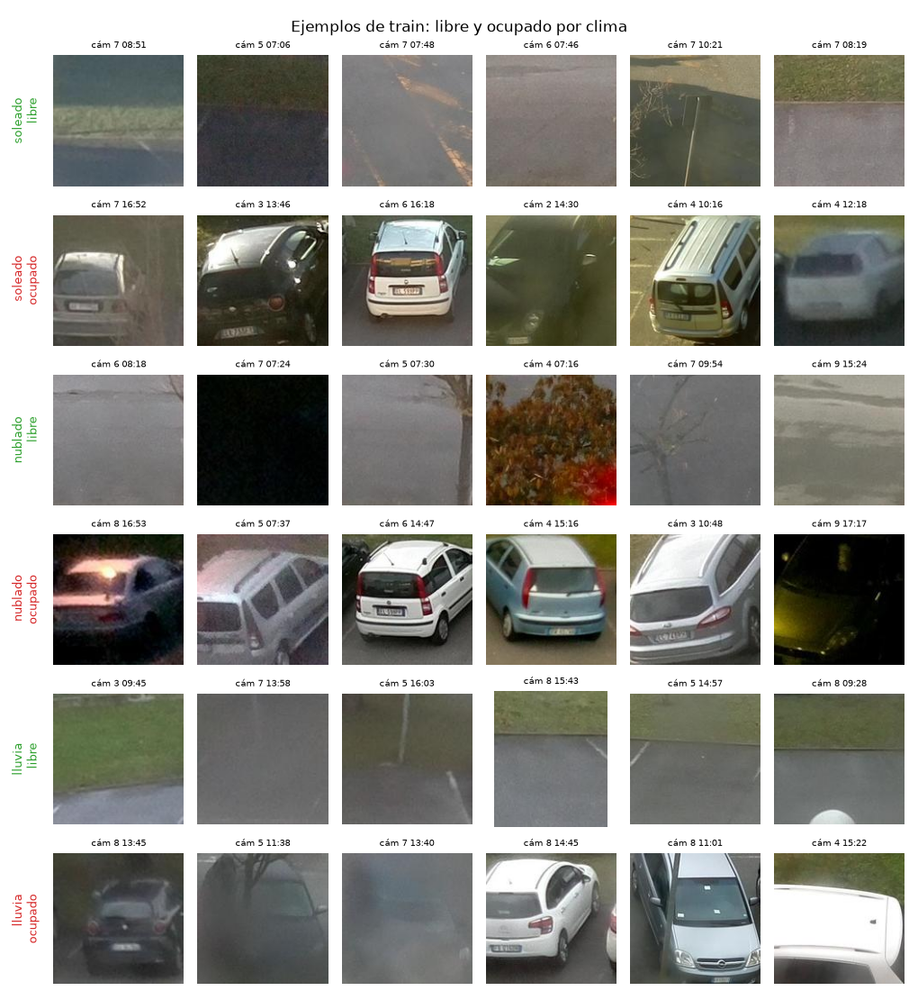

Cámara 6, 2015-11-27 09:18 (soleado): 44 cajas, 44 con etiqueta (16 ocupadas).

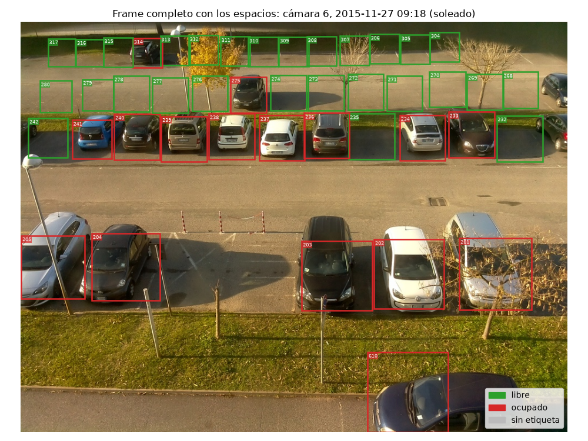

## 8. Representatividad

| partición | primera hora | última hora | patches 18h o después | % 18h o después |
|---|---|---|---|---|
| train | 07:00 | 17:54 | 0 | 0.0 |
| val | 07:10 | 17:11 | 0 | 0.0 |
| test | 07:06 | 18:12 | 28 | 0.1 |
| ood | 08:05 | 18:05 | 208 | 1.7 |

- **Solo hay imágenes de día:** de 07:00 a 18:12. No hay imágenes nocturnas, y las 18h casi no tienen
  cobertura (ver tabla). El modelo no está validado de noche; en la app eso debe ir a "por verificar" o declararse
  fuera de alcance.
- **Un solo tipo de parqueo:** CNR-EXT es el parqueo de un campus de investigación en Pisa (Italia), con cámaras
  elevadas en edificios y vistas en diagonal. Diferencias esperables con un parqueo guatemalteco (UVG o comercial):
  - sol más alto e intenso todo el año, con sombras duras y reflejos;
  - lluvias fuertes por la tarde en la época lluviosa (mayo-octubre), y val no tiene lluvia para medir ese caso;
  - otra mezcla de vehículos: más pickups, camionetas y motos, que pueden ocupar el espacio solo en parte;
  - cámaras a otra altura o ángulo, techos o pérgolas, y líneas de parqueo menos visibles;
  - horarios de ocupación distintos (clases y jornadas laborales).
- Por eso el resultado en ood (otro parqueo y otras cámaras) es la mejor señal disponible de cuánto se degrada el
  modelo al instalarlo en un lugar nuevo; para la UVG haría falta una calibración con fotos propias.

## 9. Preprocesamiento derivado del EDA

- **Normalización fija de ImageNet** (media (0.485, 0.456, 0.406), desviación (0.229, 0.224, 0.225)): no se calculan
  estadísticas con los datos, así que no hay fuga de val ni de test hacia el preprocesamiento.
- **Resize** de los patches (150x150) al tamaño de entrada de cada modelo. El mismo paso absorbe los
  322 patches de la muestra que no miden 150x150 (recortes de borde, sección 6).
- **ColorJitter** (brillo, contraste, saturación y tono) solo en entrenamiento: en la muestra hay 94 imágenes muy
  oscuras y 13 sobreexpuestas de 12,000 (0.9 %), y el brillo cambia con la
  hora y el clima (sección 5). El aumento de datos reduce la dependencia del modelo respecto de la iluminación.

## 10. Licencia y privacidad

- **Licencia:** CNRPark+EXT se distribuye bajo la *Open Data Commons Open Database License (ODbL) v1.0*
  (según cnrpark.it). Permite usar, adaptar y redistribuir, incluso con fines comerciales, con atribución
  y compartiendo bajo la misma licencia las bases de datos derivadas.
- **Privacidad:** los autores redujeron los frames completos de 2592x1944 a 1000x750 "por motivos de privacidad".
  Los patches de 150x150 recortan solo el espacio de parqueo. No usamos datos personales adicionales y la galería
  de la app solo muestra imágenes del dataset, con atribución.
- **Citas:**
  - [1] G. Amato, F. Carrara, F. Falchi, C. Gennaro, C. Meghini, C. Vairo, "Deep learning for decentralized parking
    lot occupancy detection", *Expert Systems with Applications*, 72, 327-334, 2017.
  - [2] G. Amato, F. Carrara, F. Falchi, C. Gennaro, C. Vairo, "Car parking occupancy detection using smart camera
    networks and deep learning", *IEEE ISCC 2016*, 1212-1217.
